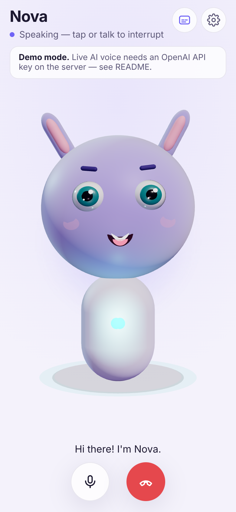
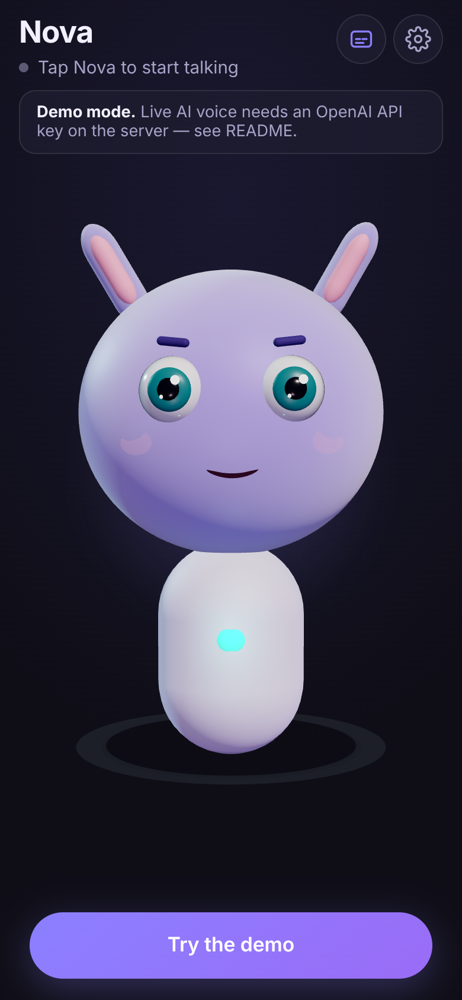
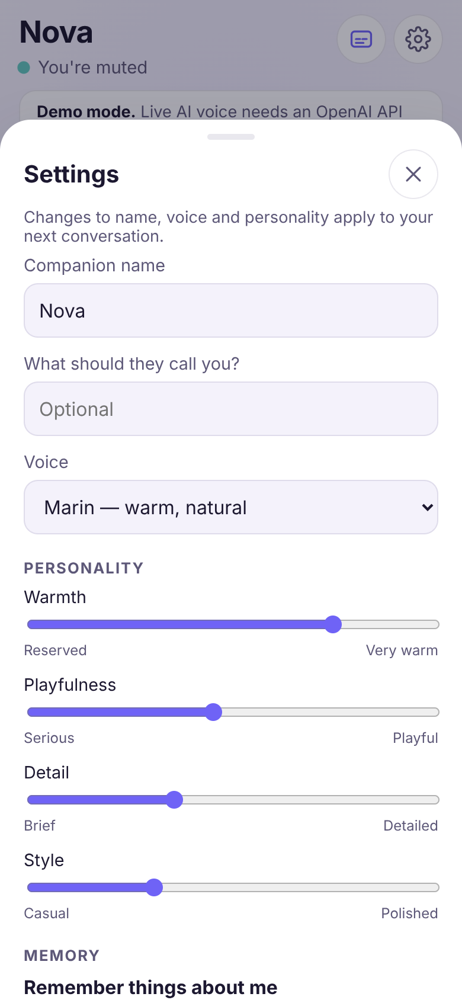

# Companion — an animated AI you can talk to

A mobile-first web app where you have a natural voice conversation with **Nova**, a friendly animated 3D character, powered by the OpenAI Realtime API. It's built to become an iOS app later.

<p align="center">
  
  
  
</p>

## Status: Phase 1 MVP

| Feature | Status |
|---|---|
| 3D character (procedural, no model files): blinking, idle breathing and sway, eye saccades, gaze that follows the pointer | ✅ Working |
| Audio-driven mouth: jaw open, wide vs. round, sibilants. Uses spectrum analysis of the AI's voice | ✅ Working (approximate, not phoneme-accurate) |
| Listening reactions: ears perk up, leans in, eyes widen, floor halo reacts to your mic level | ✅ Working |
| Expressions: happy, curious, thinking, concerned (picked from conversation state plus live transcript keywords) | ✅ Working (keyword heuristic) |
| Real-time two-way voice over WebRTC with the OpenAI Realtime API | ✅ Implemented, needs an `OPENAI_API_KEY` (see note below) |
| Interruptions: talk over it (server VAD barge-in) or tap the character | ✅ Implemented |
| Mic permission handling, mute, end call, screen wake-lock | ✅ Working |
| Live captions for both sides | ✅ Implemented (user captions come from the transcription model) |
| Custom companion name, your name, voice, 4 personality sliders | ✅ Working |
| Opt-in memory: the model calls a `remember_preference` tool, facts are stored only on the device, and you can view or delete them in Settings | ✅ Implemented |
| Light, dark and system themes; reduced-motion support; installable PWA manifest | ✅ Working |
| Secure keys: the permanent key stays on the server, and the browser gets a 2-minute ephemeral token. Also: same-origin check, rate limit, optional beta access code | ✅ Working |
| **Demo mode**: scripted offline conversation using browser TTS and volume-based turn detection, so you can try the experience without a key | ✅ Working (it doesn't understand speech) |
| Conversation history, accounts, subscriptions, iOS app, more avatars | 🔜 Planned (see [docs/ROADMAP.md](docs/ROADMAP.md)) |

> **Note on live voice testing:** the build environment has no OpenAI key and can't reach `api.openai.com`, so the live path (token minting → WebRTC → events) has not been run end to end against OpenAI. It follows the GA Realtime API (`/v1/realtime/client_secrets` and `/v1/realtime/calls`). The event handling has unit tests, and the server route was checked for its "not configured" behaviour. **Your first test with a real key is the first end-to-end run.** If OpenAI has renamed a model or event since, the fix is a one-line change in `src/app/api/session/route.ts` or `src/lib/realtime/eventRouter.ts`.

## Quick start

Requires Node 20+.

```bash
npm install
cp .env.example .env.local     # then paste your OpenAI key into OPENAI_API_KEY
npm run dev                    # http://localhost:3000
```

- Without a key, the app runs in **demo mode** automatically.
- Microphones need a secure context. `localhost` works. To test on your phone, deploy (below) or use an HTTPS tunnel such as `npx localtunnel --port 3000` or `cloudflared tunnel --url http://localhost:3000`.
- Get an API key at <https://platform.openai.com/api-keys>. Set a monthly **usage limit** on your OpenAI project before sharing the app.

### Scripts

| Command | What it does |
|---|---|
| `npm run dev` | Dev server |
| `npm run build && npm start` | Production build and serve |
| `npm test` | Unit tests (lip-sync, event router, settings/memory sanitizing, prompt builder, rate limiter) |
| `npm run typecheck` | TypeScript |

### Environment variables

| Name | Required | Default | Purpose |
|---|---|---|---|
| `OPENAI_API_KEY` | for live voice | – | Server-only. Never prefix it with `NEXT_PUBLIC_`. |
| `OPENAI_REALTIME_MODEL` | no | `gpt-realtime` | Use a newer one (e.g. `gpt-realtime-2`) or a mini model to cut cost |
| `OPENAI_TRANSCRIBE_MODEL` | no | `gpt-4o-mini-transcribe` | Captions of what the user said |
| `APP_ACCESS_CODE` | no | – | If set, users must enter this code in Settings (private beta gate) |
| `SESSION_RATE_LIMIT` | no | `20` | Sessions per IP per 10 minutes (in-memory, per instance) |

## Deploying to Vercel

1. Push this repo to GitHub (already done if you're reading this there).
2. At <https://vercel.com/new>, import the repo. Vercel detects Next.js, so no config is needed.
3. Under **Settings → Environment Variables**, add `OPENAI_API_KEY`. If the URL is public, also add `APP_ACCESS_CODE`.
4. Deploy. You get an HTTPS URL that works on iPhone Safari. Use **Share → Add to Home Screen** for an app-like, full-screen experience.

CLI alternative: `npm i -g vercel && vercel && vercel env add OPENAI_API_KEY && vercel --prod`.

> I (Claude) did not deploy this. Deployment needs your Vercel account and your OpenAI key. Run the steps above, or give me authorization and credentials in an environment that has them.

## Architecture

```
 Browser (phone)                                   Your server (Vercel)           OpenAI
 ───────────────                                   ────────────────────           ──────
 CompanionApp (React)                                                       
   │ tap "Start"                                                            
   ├─ getUserMedia (mic)                                                    
   ├─ POST /api/session {settings, memories} ───────▶ validate + rate-limit       
   │                                                 build instructions          
   │                                                 POST /v1/realtime/client_secrets ─▶ ephemeral key (2 min)
   │      ◀──────────────────── {clientSecret} ──────┘                          
   ├─ RTCPeerConnection: mic track + "oai-events" data channel                 
   └─ POST /v1/realtime/calls (SDP, Bearer ephemeral key) ───────────────────────────▶ WebRTC session
          ◀═══════════ AI voice audio track ══════════════════════════════════════════
          ◀────────── JSON events (VAD, transcripts, tool calls) ─────────────────────
   AnalyserNode(AI audio) ─▶ lip-sync ─┐
   AnalyserNode(mic)      ─▶ level   ──┼─▶ AvatarSignals (mutable, read every frame) ─▶ R3F Character
   RealtimeEventRouter    ─▶ state ────┘
```

Key files:

| Path | Role |
|---|---|
| `src/app/api/session/route.ts` | Mints ephemeral Realtime tokens. Locks the model, voice, instructions and tools on the server side |
| `src/lib/persona.ts` | Turns name, personality sliders and memories into system instructions, and defines the `remember_preference` tool |
| `src/lib/realtime/RealtimeClient.ts` | WebRTC connection, mic, audio playback, mute, interrupt |
| `src/lib/realtime/eventRouter.ts` | Realtime events → UI state, captions, tool-call handling (pure, unit-tested) |
| `src/lib/audio/lipsync.ts` | Spectrum → mouth shape (open / wide / round), smoothing |
| `src/lib/demo/DemoClient.ts` | Offline demo engine with the same interface as the live client |
| `src/components/avatar/Character.tsx` | The 3D character and all of its procedural animation |
| `src/components/CompanionApp.tsx` | Screen layout, controls, state wiring |
| `src/components/SettingsSheet.tsx` | Name, voice, personality, memory, theme |

Design decisions:

- **WebRTC, not WebSockets.** The browser handles echo cancellation, jitter and playback, and the server sees no audio. That means lower latency and no media servers to run.
- **Ephemeral keys.** The browser only ever holds a token that expires in 120 s and is bound to a session config the server chose. Users can't swap in a different model or instructions.
- **The avatar is procedural.** It needs no GLB download, renders quickly on phones, and every feature (eyes, brows, mouth) is directly controllable. Swapping in a rigged GLB character with blendshapes is a drop-in Phase 2 upgrade, because the animation inputs (`AvatarSignals`) stay the same.
- **Animation bypasses React.** Audio levels and mouth shapes are sampled inside `useFrame` from a mutable signals object, so there are no 60 fps re-renders.
- **Privacy.** Settings and memories live in `localStorage` on the device. Memory is off by default, the model can only *request* to remember something, and the client refuses when memory is disabled.

## Estimated monthly operating costs

Prices change; check <https://openai.com/api/pricing> before relying on these. The figures assume about **$32 / $64 per 1M audio input/output tokens** for the flagship realtime model and about **$10 / $20** for the mini tier. Audio uses about 600 tokens per minute of user speech and about 1,200 per minute of AI speech. Earlier turns are re-sent as (mostly cached, ~$0.40/1M) input.

| Item | Rough cost |
|---|---|
| Voice, flagship model | **~$0.06–$0.15 per conversation minute** (rises with long sessions) |
| Voice, mini model | **~$0.02–$0.05 per conversation minute** |
| Transcription for captions | ~$0.003 per minute |
| Vercel hosting | Hobby $0 (non-commercial only) → Pro $20 per seat per month |
| Apple Developer Program (for iOS) | $99 per year |

| Scenario | Usage | Flagship | Mini |
|---|---|---|---|
| Personal / testing | 5 h per month | ~$20–45 | ~$6–15 |
| Small beta | 100 users × 1 h | ~$360–900 | ~$120–300 |
| Launch | 1,000 users × 2 h | ~$7k–18k | ~$2.4k–6k |

Voice AI is the dominant cost. Before launch: default to the mini model, cap session length, and price subscriptions per minute of use (see the roadmap).

## Roadmap

See **[docs/ROADMAP.md](docs/ROADMAP.md)**. It covers Phase 2 (better lip-sync, expressions, history), Phase 3 (accounts, subscriptions, deployment hardening), the iOS app plan and App Store requirements.
